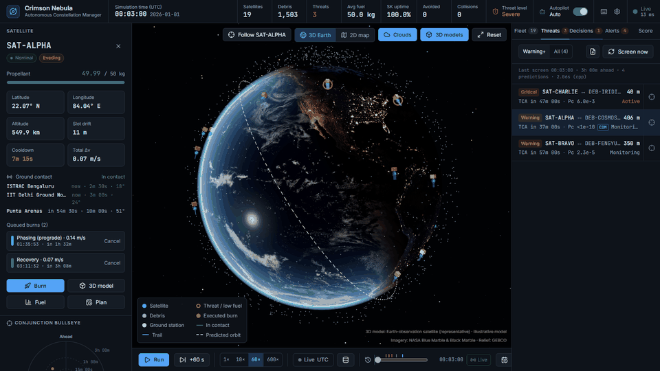
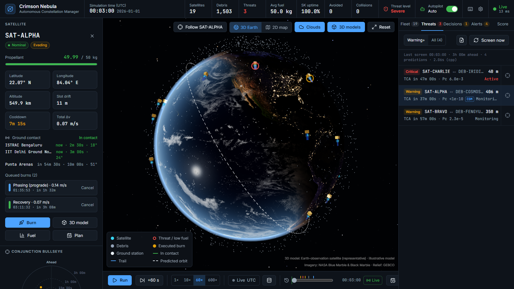
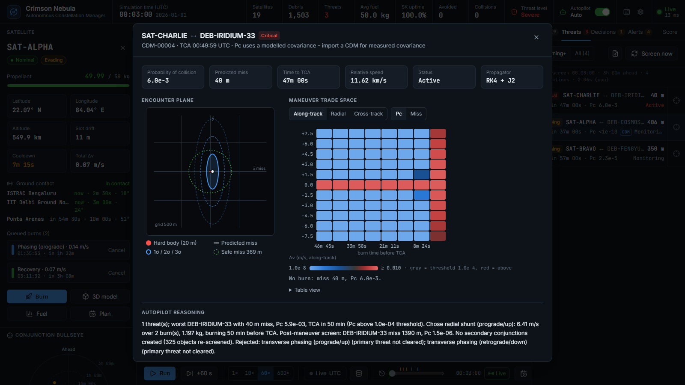
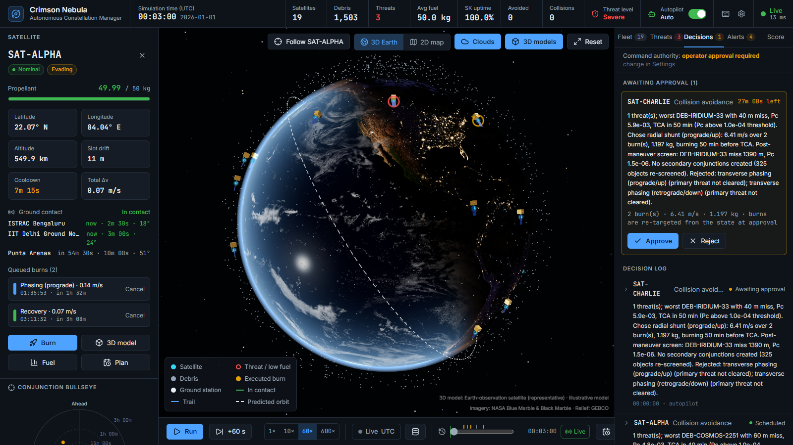
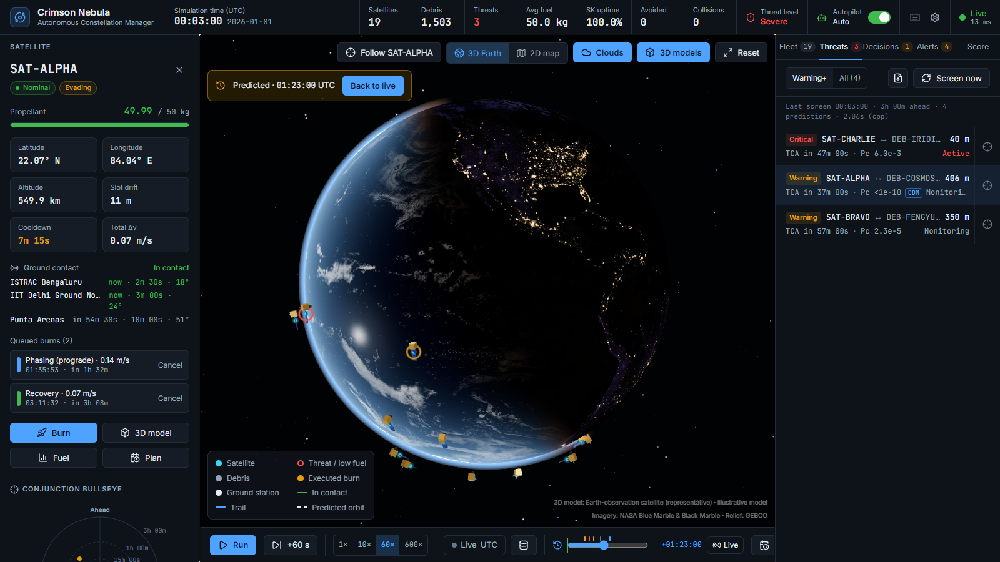
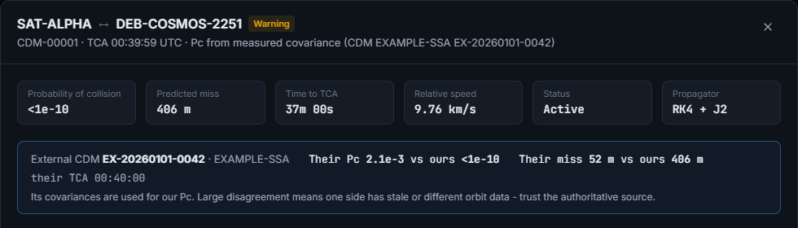
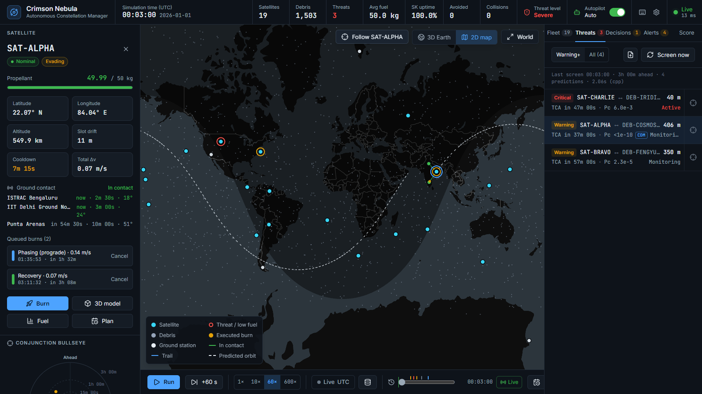
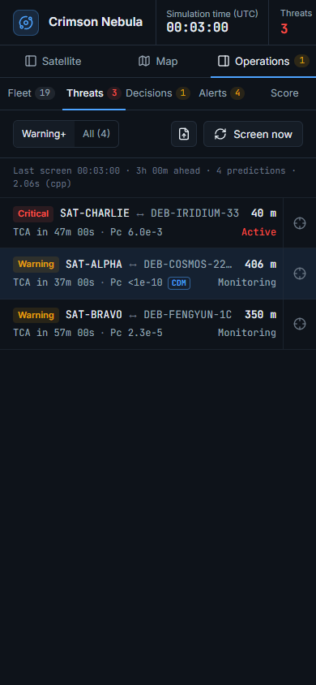
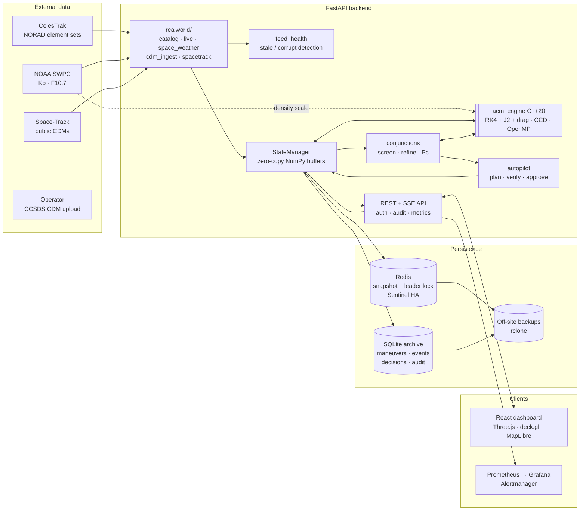
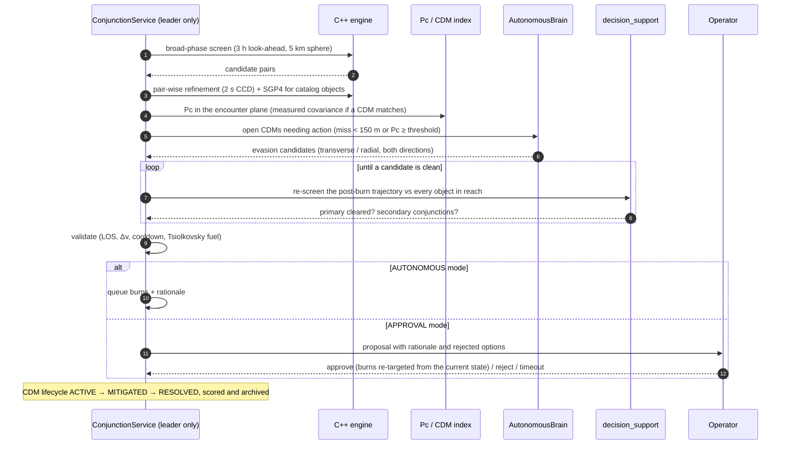

# 🛰️ Crimson Nebula: Autonomous Constellation Manager & Orbital Visualizer

[](https://github.com/projectideamaterials1-dev/NSH/actions/workflows/ci-cd.yml)
[](https://python.org)
[](https://fastapi.tiangolo.com)
[](backend/acm_engine/physics_rk4.cpp)
[](https://react.dev)
[](https://docker.com)

**Crimson Nebula** is a full-stack autonomous constellation manager. It tracks a fleet of
satellites against tens of thousands of debris objects, predicts close approaches and their
**probability of collision**, plans fuel-efficient avoidance maneuvers and checks them against
the post-burn trajectory. It explains every decision in plain language and can hold each burn for
operator approval. Everything is visualised live on a photorealistic 3D Earth.

The physics core is a C++20 engine (RK4, J2 and atmospheric drag; continuous collision detection
with a spatial hash; OpenMP), called from a FastAPI backend that runs on real CelesTrak element
sets, NOAA space weather and Space-Track conjunction messages.

<p align="center">
  
</p>

> **Not certified SSA.** This is a simulation and decision-support system; it does not command
> real spacecraft. Pc uses a covariance model unless measured covariance is supplied in a CDM.
> See [docs/VALIDATION.md](docs/VALIDATION.md) for what was validated and how far to trust it.

---

## Contents

- [Screenshots](#-screenshots)
- [What it does](#-what-it-does)
- [Architecture](#%EF%B8%8F-architecture)
- [Design decisions](#-design-decisions)
- [Physics and mathematics](#-physics-and-mathematics)
- [Getting started](#-getting-started)
- [Production deployment](#-production-deployment)
- [Configuration](#%EF%B8%8F-configuration)
- [API](#-api)
- [Testing and validation](#-testing-and-validation)
- [Project structure](#-project-structure)

---

## 📸 Screenshots

**Mission control.** Selected satellite with its queued avoidance burns and ground contacts; the
threat list ranks conjunctions by risk and probability of collision (Pc).



| Conjunction close-up | Human in the loop |
|---|---|
|  |  |
| Encounter plane with 1/2/3-σ uncertainty ellipses, hard-body and safe-miss circles. The maneuver trade space shows Pc for every burn time × Δv, on a diverging scale around the maneuver threshold. Below it is the autopilot's reasoning. | Approval mode holds each plan as a proposal with its rationale, the options it rejected and a countdown. The decision log records every plan, rejection and approval. |

| Predicted look-ahead | External CDM cross-check |
|---|---|
|  |  |
| The time scrubber continues past "now" into predicted positions, with queued burns applied. Ticks mark upcoming conjunctions (red/amber) and burns (blue). | An imported CCSDS CDM with measured covariance replaces the covariance model for that encounter. Its Pc and miss distance are shown next to ours. |

| 2D map | Phone layout |
|---|---|
|  |  |
| Deck.gl over a MapLibre basemap: day/night terminator, ground stations, predicted orbit and threat rings. | Below the `lg` breakpoint the three panes become switchable views. |

---

## ✨ What it does

| Area | Capability |
|---|---|
| **Propagation** | RK4 with J2 and atmospheric drag (exponential atmosphere scaled by live NOAA F10.7/Kp, per-object ballistic coefficients from B*). The C++ engine has a NumPy fallback, and both give identical results. |
| **Screening** | Broad phase over the whole catalogue (spatial hash + continuous collision detection), then pair-wise refinement to the true TCA, refined again with SGP4 for catalog objects. |
| **Collision probability** | 2-D short-encounter Pc in the encounter plane. It uses a time-scaled covariance model, or the **measured covariance** from an imported CCSDS CDM. |
| **Autonomous avoidance** | Transverse phasing or radial shunt (plus recovery), sized to reach the miss at which Pc falls a decade below threshold. Also handles station-keeping returns and end-of-life graveyard burns. |
| **Verified maneuvers** | Every evasion is re-screened along its post-burn path. A plan that leaves the threat uncleared or creates a secondary conjunction is replaced by the mirrored or other-axis alternative. |
| **Explainability** | A plain-language rationale for every decision, including the options considered and why they were rejected (`GET /api/decisions`). |
| **Human in the loop** | APPROVAL mode turns plans into proposals. Approval re-targets the burns from the current state, and unanswered proposals expire or execute according to policy. |
| **Trade space** | Miss distance, Pc and propellant over a burn-time × Δv grid for any conjunction. |
| **Real-world data** | CelesTrak element sets (SGP4, live UTC clock), NOAA SWPC space weather, Space-Track public CDMs, and CCSDS CDM upload. |
| **Operations** | Prometheus metrics, Grafana dashboard and 16 alert rules with runbooks. Feed-health monitoring rejects corrupt downloads. Named users with an audit trail. |
| **Reliability** | Redis snapshots with leader election, Sentinel failover, a SQLite mission archive, scheduled verified off-site backups, and health-gated deploys with rollback. |

---

## 🏗️ Architecture



### The autonomy loop



---

## 🧭 Design decisions

Each choice and the trade-off it makes:

| Decision | Why | Trade-off |
|---|---|---|
| **C++20 engine via pybind11, with a NumPy fallback** | Screening 20k objects over a 3 h horizon is millions of RK4 steps. OpenMP C++ runs about 10× faster than vectorised NumPy and mutates the NumPy buffers in place, so nothing is copied. | Two implementations of the force model. Tests assert the engines agree to < 1e-6 km, including with per-object drag. |
| **Zero-copy contiguous state buffers** | Telemetry, physics, screening and snapshots all work on the same `(N, 6)` arrays. Row indices are stable and compacted on removal. | Anything indexed by row (planner locks, ballistic coefficients) must follow compaction. `remove_satellites` returns a remap for that. |
| **Two-stage screening (CCD broad phase → refinement)** | A 5 km sphere with linear CCD over 5 s chunks catches every candidate cheaply. Refinement then spends effort only on pairs that matter. Under overload, refinement is bounded to the riskiest pairs, and the broad phase still covers everything. | Refinement accuracy is bounded by the 2 s CCD step (sub-metre at LEO speeds). |
| **Pc with a modelled covariance, replaced by measured covariance when available** | Pc is the metric operators decide on. A miss-distance threshold ignores uncertainty. Real orbit-determination covariance only exists in CDMs, so the model is the honest fallback and the UI says which one is in use. | A modelled Pc is good for ranking, not for real go/no-go decisions. |
| **Verify every evasion against the post-burn trajectory** | A dodge that flies into another object is worse than no dodge. Re-screening the new path segment by segment, with an orbit-shell prefilter, catches that before uplink. | Seconds of extra compute per evasion, run off the event loop. |
| **Approval re-targets burns from the current state** | An approval that arrives minutes later must not uplink Δv vectors computed for a different orbital position. Proposals store RTN burns and recompute the ECI vectors at approval time. | The plan executes a few minutes later than first proposed, which the countdown makes visible. |
| **Drag-free station-keeping "ghost slots"** | The slot is the maintained reference orbit. Propagating it without drag makes real decay show up as drift, which station-keeping then corrects, as in reality. | The slot is an idealisation and does not model the operator's own orbit maintenance plan. |
| **Redis snapshot + leader election, SQLite for history** | Redis holds the hot state every replica can restore. A TTL leader lock ensures only one replica runs the autopilot, and non-leaders reject writes with 503. Append-only history belongs in SQLite. | The archive is per-replica. Redis replication is asynchronous, so up to one autosave interval (10 s) can be lost in a failover. |
| **Sentinel monitors masters by IP** | A stopped container's hostname stops resolving, so a hostname-monitoring sentinel goes into TILT and never fails over. This was found by killing the primary on the real stack. | The data nodes need fixed addresses on the compose network. |
| **Feed health with cache fallback** | CelesTrak and NOAA have no SLA. A truncated or corrupt download is rejected in favour of the cached copy, and every feed reports ok / degraded / stale / error, with events and alerts. | Detection is heuristic (sanity checks, size drop). |
| **`copy`, not `sync`, for off-site backups** | Local pruning must never delete off-site history. Retention there belongs to the bucket's lifecycle rules. | Off-site storage grows until lifecycle rules expire it. |
| **Hashed, expiring, named API keys + audit log** | The audit trail must say *who* approved a burn. Keys are stored as hashes, rotation has an overlap window, and the users file is re-read without a restart. | API keys, not SSO. OIDC is the next step for interactive users. |

---

## 🧠 Physics and mathematics

Full model notes and validation: **[docs/VALIDATION.md](docs/VALIDATION.md)**.

### Equations of motion (two-body + J2 + drag)

$$\ddot{\vec r} = -\frac{\mu}{r^3}\vec r + \vec a_{J2} + \vec a_{drag}$$

$$\vec a_{J2} = \frac{3}{2}J_2\,\mu\frac{R_E^2}{r^5}\begin{pmatrix} x\,(5z^2/r^2-1)\\ y\,(5z^2/r^2-1)\\ z\,(5z^2/r^2-3)\end{pmatrix}, \qquad
\vec a_{drag} = -\tfrac12\,\rho(h)\,s\,B\,\lVert\vec v_{rel}\rVert\,\vec v_{rel}$$

- $\mu = 398600.4418\ \text{km}^3/\text{s}^2$, $R_E = 6378.137\ \text{km}$, $J_2 = 1.08263\times10^{-3}$
- $\vec v_{rel} = \vec v - \vec\omega_E\times\vec r$ (co-rotating atmosphere)
- $\rho(h) = \rho_0 e^{-(h-h_0)/H}$: piecewise exponential atmosphere (Vallado, Table 8-4)
- $s$: activity multiplier from a Jacchia-style exospheric temperature
  $T_\infty = 379 + 3.24\,F_{10.7} + 28\,K_p + 0.03\,e^{K_p}$, with scale height $\propto T_\infty$
- $B = C_d A/m$ per object, derived from the element set's B* where available:
  $B = 2B^*/\rho_0$, $\rho_0 = 0.15696615\ \text{kg/m}^2/\text{ER}$
- Integrated with fixed-step RK4 (1 s): $\vec y_{n+1} = \vec y_n + \frac{\Delta t}{6}(\vec k_1 + 2\vec k_2 + 2\vec k_3 + \vec k_4)$

### Conjunction detection

Within each chunk, the relative motion is linear and the time of closest approach is

$$t_{CA} = \operatorname{clamp}\!\left(-\frac{\Delta\vec r\cdot\Delta\vec v}{\lVert\Delta\vec v\rVert^2},\,0,\,\Delta t\right)$$

The 100 km spatial-hash cells exceed the worst-case closing distance per 5 s chunk (~79 km for
head-on LEO), so no pair is missed between chunks.

### Probability of collision (short-encounter, Foster/Alfano)

Project the combined position covariance $C = C_{sat} + C_{obj}$ (each rotated from its RTN frame)
onto the encounter plane spanned by the miss vector $\hat x$ and $\hat y = \hat z\times\hat x$
($\hat z \parallel \vec v_{rel}$). Then integrate the 2-D Gaussian over the hard-body circle:

$$P_c = \iint_{\lVert\vec\rho\rVert\le R_{HB}} \frac{1}{2\pi\sqrt{|C_2|}}\exp\!\left(-\tfrac12(\vec\rho-\vec m)^\top C_2^{-1}(\vec\rho-\vec m)\right)d\vec\rho$$

This is evaluated in the covariance principal axes as a 1-D Gauss–Legendre integral with an
analytic erf inner term. It is checked against the isotropic closed form
$1-e^{-R^2/2\sigma^2}$ and the small-hard-body approximation. Risk is CRITICAL at
$P_c \ge 10^{-4}$ (configurable) or a miss under 100 m, and WARNING at $P_c \ge 10^{-6}$ or a miss
under 1 km.

### Maneuvers

Along-track phasing displacement after drift time $t$ (Clohessy–Wiltshire):
$\delta y \approx \frac{\Delta v_T}{n}\lvert 4\sin nt - 3nt\rvert$. Radial:
$\delta x \approx \frac{\Delta v_R}{n}\lvert\sin nt\rvert$. Burns are sized to reach the miss
distance at which Pc falls a decade below threshold. Each burn must satisfy $\lVert\Delta\vec v\rVert \le 15$ m/s, a 600 s thermal cooldown and line of sight to a ground
station (elevation ≥ the station's mask). Propellant follows Tsiolkovsky:

$$\Delta m = m_{wet}\left(1 - e^{-\Delta v/(I_{sp}g_0)}\right), \qquad I_{sp} = 300\ \text{s}$$

### Validation highlights

| Check | Result |
|---|---|
| Engine vs SGP4, ISS, 24 h | 2.1 km with drag (3.1 km without) |
| Engine vs SGP4, CSS (Tianhe), 24 h | 2.4 km with drag (6.4 km without) |
| J2 nodal regression vs $-\tfrac32 nJ_2(R/a)^2\cos i$ | within 3 % at 28.5°, 51.6° and 97.4° |
| Drag decay per revolution vs $-2\pi B\rho a^2$ | within 10 % |
| Pc integral vs closed forms | relative error < 1e-6 (isotropic), < 1e-3 (small hard body) |

---

## 🚀 Getting started

```bash
# Windows
.\run.ps1 -Demo            # backend + dashboard, seeded demo mission
.\run.ps1 -Live            # real satellites and debris in real time (CelesTrak)

# Linux / macOS
./run.sh --demo
./run.sh --live
```

Then open http://localhost:3000. Press <kbd>?</kbd> for keyboard shortcuts: <kbd>Space</kbd>
run/pause, <kbd>←</kbd>/<kbd>→</kbd> scrub into the past or the prediction, <kbd>T</kbd>/<kbd>D</kbd>
for the Threats/Decisions tabs, <kbd>P</kbd> for the performance overlay.

<details>
<summary>Manual setup</summary>

```bash
cd backend
python3 -m venv .venv && source .venv/bin/activate    # Windows: .venv\Scripts\activate
pip install -r requirements-dev.txt
pip install .                     # builds the C++ engine (C++20 compiler; macOS: brew install libomp)
uvicorn satellite_api.main:app --port 8000          # API docs: http://localhost:8000/docs

cd ../frontend
npm install && npm run dev                           # http://localhost:3000, proxies /api to :8000
```

Seed the demo mission into a running backend with `backend/scripts/demo.py` (50 satellites,
10,000 debris, planted threats). `backend/test.py` runs a 30-day stress simulation.
</details>

---

## 🐳 Production deployment

```bash
cp .env.example .env                        # set REDIS_PASSWORD (openssl rand -hex 32)
./scripts/generate-dev-cert.sh              # local/staging only - mount a real cert in production
docker compose -f docker-compose.prod.yml up -d

# named operator accounts (keys are hashed; rotation needs no restart)
docker compose -f docker-compose.prod.yml exec backend python3 scripts/apikeys.py add-user alice --role operator
docker compose -f docker-compose.prod.yml exec backend python3 scripts/apikeys.py issue alice
```

The base stack is the backend (non-root, CPU/memory-limited), password-protected Redis, and nginx
terminating TLS. Optional compose profiles add the rest:

| Profile | Adds |
|---|---|
| `monitoring` | Prometheus, Alertmanager and Grafana (provisioned dashboard and 16 alert rules), on localhost only |
| `ha` | Redis replica and three Sentinels. Set `REDIS_SENTINELS` and the backend follows failovers |
| `backup` | Scheduled, verified, pruned backups, plus an rclone off-site copier (configure `backup.env`) |

```bash
docker compose -f docker-compose.prod.yml --profile monitoring --profile ha --profile backup up -d
```

Releases: pushing a `v*` tag runs CI, scans the image with Trivy, publishes it to GHCR, and (when
the `production` environment's `DEPLOY_*` secrets are set) rolls the host with
[`scripts/deploy.sh`](scripts/deploy.sh). The script takes a pre-deploy backup, gates the rollout on
health checks and rolls back automatically. Operational procedures for every alert are in
**[docs/RUNBOOKS.md](docs/RUNBOOKS.md)**.

---

## ⚙️ Configuration

All variables are documented in [`.env.example`](.env.example). The main ones:

| Variable | Default | Purpose |
|---|---|---|
| `REDIS_URL` · `REDIS_SENTINELS` · `REDIS_SENTINEL_MASTER` | unset · unset · `acm` | Durable state (single Redis, or Sentinel HA) |
| `REQUIRE_DURABLE_STATE` | `0` | Refuse to start without Redis instead of running in memory |
| `API_USERS_FILE` | `data/api_users.json` | Named users and hashed keys (`scripts/apikeys.py`) |
| `API_KEYS_OPERATOR` · `API_KEYS_READONLY` | unset | Legacy shared keys |
| `METRICS_TOKEN` | unset | Bearer token required by `/metrics` |
| `RATE_LIMIT_PER_MINUTE` · `TRUSTED_PROXY_IPS` | `0` · unset | Per-client rate limit on `/api/*` |
| `REALWORLD_FLEET` · `REALWORLD_OBJECTS` · `REALWORLD_LIVE` | see example | CelesTrak sources loaded on start; live UTC clock |
| `SPACETRACK_IDENTITY` · `SPACETRACK_PASSWORD` | unset | Poll Space-Track public CDMs hourly |
| `FEED_CELESTRAK_STALE_S` · `FEED_NOAA_STALE_S` | `21600` · `7200` | Feed staleness thresholds |
| `BACKUP_INTERVAL` · `BACKUP_KEEP` | `6h` · `28` | Scheduled backups (`backup` profile) |
| `AUTOPILOT` · `CDM_HORIZON_S` · `CDM_SCREEN_INTERVAL_S` | `1` · `10800` · `600` | Autonomy and screening cadence |

Runtime settings can be changed from the dashboard's **Settings** (`POST /api/config`) and are
persisted to `data/config.json`. They include spacecraft limits, screening, the Pc threshold,
hard-body radius, covariance scale, drag, command authority (autonomous / approval), the approval
timeout and maneuver verification.

---

## 📡 API

Interactive schemas are at `/docs`. The main groups:

| Endpoint | Description |
|---|---|
| `POST /api/telemetry` | Ingest ECI state vectors (optional per-object `ballistic_coefficient`) |
| `POST /api/simulate/step` | Advance the simulation (burns split the step at their epochs) |
| `POST /api/maneuver/schedule` · `POST /api/maneuver/manual` | Schedule, or plan and validate, RTN/ECI burns |
| `GET /api/visualization/snapshot` · `GET /api/stream/snapshot` | Snapshot (JSON) and live SSE stream |
| `GET /api/predict` | Look-ahead satellite frames with queued burns applied, plus upcoming TCA/burn events |
| `GET /api/conjunctions` · `POST /api/conjunctions/screen` | CDMs with TCA, miss, Pc, encounter-plane geometry and external comparison |
| `GET /api/conjunctions/{id}/tradespace` | Miss / Pc / propellant over burn time × Δv |
| `POST /api/cdm` · `GET /api/cdm` | Import CCSDS CDMs (KVN/JSON) or Space-Track records; list received CDMs |
| `GET /api/decisions` | Autopilot decision log with rationale and candidates |
| `GET /api/proposals` · `POST /api/proposals/{id}/approve` · `/reject` | Human-in-the-loop approvals |
| `GET /api/physics` | Force model, drag/space-weather coupling and Pc model in use |
| `GET /api/feeds` | CelesTrak / NOAA / Space-Track feed health |
| `GET /api/audit` | Audit trail of writes and rejected keys (operator only) |
| `GET /api/metrics` · `GET /metrics` | Mission scorecard · Prometheus exposition |
| `/api/catalog/*` · `/api/live` · `/api/space-weather` | Real-world catalog, live clock, NOAA space weather |
| `GET /api/satellites` · `/{id}/track` · `/{id}/passes` | Per-satellite details, ground track, ground-station passes |
| `GET /api/archive/maneuvers` · `/events` · `GET /api/export/czml` | History and Cesium export |
| `GET /health` | Engine, persistence/Redis mode, leadership, feed summary |

---

## 🧪 Testing and validation

| Suite | What it covers | Run |
|---|---|---|
| **Backend** (140 tests, 80 % coverage gate) | Engines and drag, Pc, screening and CDM lifecycle, autopilot avoidance, secondary-conjunction replacement, approvals, CDM ingestion, identity/audit, Redis/Sentinel clients, backups, feed health, fault injection, property-based tests | `cd backend && pytest tests --ignore=tests/benchmark` |
| **Propagation validation** | Engine vs SGP4 (24 h), J2 nodal regression, drag decay | `python backend/scripts/validate_propagation.py` |
| **Frontend unit** (27 tests, coverage gate) | Formatting, geometry, motion smoothing, store, selectors, shortcuts | `cd frontend && npm run test:coverage` |
| **End-to-end** (Playwright) | Dashboard flows, manual burns, simulation, 3D and 2D maps rendering, decisions, shortcuts, predicted timeline | `cd frontend && npm run test:e2e` |
| **Backup/restore** | Back up, wipe, restore, reload, against a real Redis | CI `backup-restore` job |
| **Security** | gitleaks (full history), Trivy dependency and image scans, Dependabot | CI `security` and `build-docker` jobs |
| **Benchmarks** | Screening latency, snapshot performance | `pytest tests/benchmark` |

Demo mission result (`scripts/demo.py`: 50 satellites, 10,000 debris, 6 planted 46–70 m threats):
**6/6 avoided, 0 collisions, 0.37 kg propellant, 100 % station-keeping uptime**.

---

## 📂 Project structure

```
├── Dockerfile                      # 3-stage build: frontend · C++ engine · slim non-root runtime
├── docker-compose.prod.yml         # backend, Redis, nginx + profiles: monitoring · ha · backup
├── run.sh · run.ps1                # local launchers (--demo / --live)
├── scripts/deploy.sh               # health-gated rollout with pre-deploy backup and rollback
├── monitoring/                     # Prometheus, alert rules, Alertmanager, Grafana, sentinel entrypoint
├── docs/
│   ├── VALIDATION.md               # physics model, SGP4 comparison, Pc method
│   ├── RUNBOOKS.md                 # one section per alert, backup/restore, Redis HA
│   └── images/                     # screenshots and tour GIF
├── backend/
│   ├── acm_engine/physics_rk4.cpp  # RK4 + J2 + drag, spatial hash + CCD (OpenMP)
│   ├── scripts/                    # demo.py · backup.py · apikeys.py · validate_propagation.py
│   ├── tests/                      # unit · integration · regression · benchmark
│   └── satellite_api/
│       ├── main.py                 # app, lifespan, health, audit/feeds endpoints
│       ├── physics_engine.py       # engine loader, drag model, NumPy fallback
│       ├── state.py · state_redis.py · redis_conn.py · db.py
│       ├── prediction.py · observability.py · feed_health.py · audit.py · backup.py
│       ├── middleware/             # auth (named users, shared keys), identity, rate limiting, leader gate
│       ├── acm/                    # brain · autopilot · conjunctions · collision_probability
│       │                           #   decision_support · scheduler · fleet_coordinator · plugins
│       ├── realworld/              # catalog · live · space_weather · cdm_ingest · spacetrack · validation
│       └── routers/                # telemetry · simulation · maneuvers · visualization · operations · realworld · export
└── frontend/src/
    ├── store/                      # Zustand store: types, frames, selectors, slices/*
    ├── lib/                        # earthScene + earth/* (Three.js), geo, format, shortcuts, motion smoothing
    └── components/                 # dashboard panels, ConjunctionModal, DecisionsPanel, Basemap, ShellExtras, …
```

---

## 📄 License

This project is an independent, original build. All code is my own.
