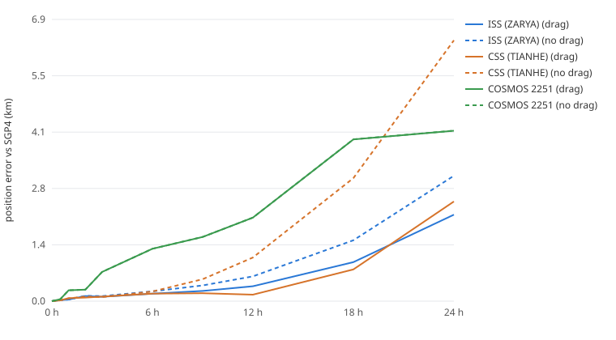

# Physics model and validation

This page records what the engine models, how it was checked, and how far to trust it.
Crimson Nebula is a simulation and decision-support tool. **Its conjunction assessments are not
certified space situational awareness (SSA).** Cross-check them against an authoritative source,
such as Space-Track CDMs from the 18th/19th Space Defense Squadron, before acting on them.

## Force model

| Term | Model | Where |
|---|---|---|
| Gravity | Two-body + J2 | `physics_engine.py`, `acm_engine/physics_rk4.cpp` |
| Atmospheric drag | Piecewise exponential atmosphere (Vallado, *Fundamentals of Astrodynamics and Applications*, Table 8-4), co-rotating with the Earth | same |
| Solar / geomagnetic activity | Density multiplier from NOAA SWPC F10.7 and Kp (Jacchia-style exospheric temperature, scale height ∝ T) | `physics_engine.density_scale` |
| Integrator | Fixed-step RK4, 1 s | same |

Each object has its own ballistic coefficient (Cd·A/m). For catalog objects it is derived from the
element set's B* term (B = 2·B*/ρ₀); telemetry can supply `ballistic_coefficient` per object.
Objects without one, or whose B* is negative or implausible (common for poorly tracked debris),
use `ballisticCoefficient` (default 0.01 m²/kg). The station-keeping *ghost slots* are propagated
**without** drag on purpose. They represent the maintained reference orbit, so a satellite's drag
decay shows up as drift from its slot, and station-keeping then has to correct it.

`GET /api/physics` reports the model in use, including the current density multiplier derived
from the latest space weather.

## Propagation vs SGP4

`scripts/validate_propagation.py` starts the engine from the SGP4 state at each element set's
epoch and compares positions over 24 h. The ballistic coefficient comes from the element set's
B* term (B = 2·B*/ρ₀).

| Object | Drag | 6 h | 24 h |
|---|---|---|---|
| ISS (ZARYA), ~420 km | on | 0.18 km | 2.12 km |
| ISS (ZARYA) | off | 0.24 km | 3.07 km |
| CSS (Tianhe), ~380 km | on | 0.19 km | 2.44 km |
| CSS (Tianhe) | off | 0.24 km | 6.38 km |
| COSMOS 2251, ~770 km | on / off | 1.28 km | 4.17 km |

Raw numbers are in [`validation/propagation_vs_sgp4.csv`](validation/propagation_vs_sgp4.csv).

- At station altitudes, modelling drag removes 30–60 % of the 24 h divergence.
- At ~770 km drag is negligible. The remaining difference comes from terms SGP4 includes and this
  engine does not (J3/J4, long-period terms), plus SGP4's mean-element theory itself. SGP4 is a
  reference, not truth: its own error against precise ephemerides is typically around 1 km at
  epoch and grows by a few km per day.

`tests/regression/test_propagation_validation.py` enforces these bounds in CI. It also checks J2
nodal regression against the analytic rate −1.5·n·J2·(R/a)²·cos i at three inclinations, to
within 3 %.

## Probability of collision

`acm/collision_probability.py` computes the 2-D short-encounter Pc (Foster 1992; Alfano 2005):

1. Build the encounter plane at TCA. x̂ is the miss vector and ẑ is the relative velocity.
2. Combine the two objects' position covariances, rotated from their RTN frames, and project the
   result onto the plane.
3. Integrate the 2-D Gaussian over the combined hard-body circle. This uses 96-point
   Gauss–Legendre quadrature with an analytic inner erf term.

Unit tests check the integration against the isotropic closed form, 1 − exp(−R²/2σ²), and against
the small-hard-body approximation.

**The covariance is a model, not an orbit-determination product.** Each object's 1-σ RTN
uncertainty grows linearly with time to TCA:

| | σ₀ (R, T, N) | growth per day (R, T, N) |
|---|---|---|
| Owned satellite (GNSS ephemeris) | 10, 40, 10 m | 5, 100, 5 m |
| Tracked object (TLE-quality) | 100, 400, 150 m | 50, 1000, 80 m |

`covarianceScale` scales both. Risk tiers combine miss distance with Pc: CRITICAL at Pc ≥
`pcManeuverThreshold` (default 1e-4, a common operator maneuver threshold) or a miss under
100 m, and WARNING at Pc ≥ 1e-6 or a miss under 1 km. For a Pc-driven encounter, evasion sizes
its burn to reach the miss distance at which Pc falls a decade below the threshold.
